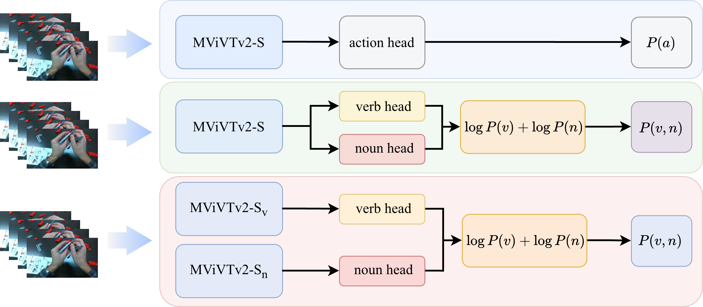

# Diagnosing Verb–Noun Decomposition in Assembly Action Recognition

**A Cross-Dataset Study of Compositional Generalization**

> *Anonymous submission — code release for double-blind review.*
> Author identities will be added in the camera-ready version.

This repository contains the full code, generated splits, and analysis pipelines
that reproduce every number, table, and figure in the paper.

---

## TL;DR

We audit the verb–noun decomposition paradigm that dominates assembly action
recognition. Across three datasets (MECCANO, HAViD, IMPACT) and the five
configurations *atomic / shared / independent / C2C-shared / C2C-indep*, we
show that:

1. **Decomposition is structurally necessary**: an atomic head assigns
   zero probability to every unseen (verb, noun) composition by construction.
2. **Realized gain is mostly coverage interpolation**: unseen accuracy
   correlates strongly with each pair's training co-occurrence ($\rho{=}0.49{-}0.69$).
3. **Failure concentrates on the larger-vocabulary component**, identifiable
   from vocabulary sizes before training. IMPACT's verb-heavy vocabulary
   flips the bottleneck from object to verb.
4. **The shared encoder forfeits a $2.2{-}6.0\times$ harmonic-mean gap to
   independent recombination**, driven by a non-transferable co-occurrence
   shortcut that shared training adds without improving seen accuracy.

---

## Framework

The paradigm comparison studied throughout:



Three architectural variants share the same input but differ in their output
space. Atomic's output is a strict subset of the verb×noun grid (so
$P(\text{unseen}){=}0$ by construction); shared and independent both span the
full grid, and the paper measures how much of that reachable space each
realizes.

---

## Main results (compositional split, harmonic mean of seen / unseen action top-1)

|              | Atomic | Shared | Independent | C2C-shared | C2C-indep |
|--------------|:------:|:------:|:-----------:|:----------:|:---------:|
| **MECCANO**  |  0.0   |  3.3   |  **19.8**   |   17.9     |   24.3    |
| **HAViD**    |  0.0   | 13.7   |  **30.2**   |   28.9     |   30.7    |
| **IMPACT**   |  0.0   | 10.6   |  **31.2**   |   22.1     |   30.9    |

All numbers are computed under a unified argmax-over-valid-pairs scoring rule
($\arg\max_{(v,n)} \log P(v){+}\log P(n)$).

The paper additionally reports per-component breakdowns, ranking-based top-$K$
recovery, the per-component shortcut diagnostic D1, the grid-density
correlation D2, the per-component error decomposition D3, the granularity
sweep D4, and a per-loss C2C objective ablation — all reproducible from this
repository (see the *Reproducing paper exhibits* section below).

---

## Repository layout

```
.
├── README.md                  this file
├── LICENSE
├── requirements.txt
├── assets/                    figures used in this README
│
├── code/                      all training / evaluation / analysis scripts (flat layout, preserves imports)
│   ├── paths.py               centralized path config (env-var overridable)
│   │
│   ├── train_*.py             one training entry-point per (dataset × config)
│   │   train_meccano_mvitv2.py        MECCANO standard split (atomic + multi-head)
│   │   train_meccano_comp.py          MECCANO compositional split (per-component heads)
│   │   train_meccano_comp_atomic.py   MECCANO atomic on the compositional split
│   │   train_impact_mvitv2.py         IMPACT standard split
│   │   train_impact_comp.py           IMPACT compositional split (shared encoder)
│   │   train_impact_comp_variants.py  IMPACT compositional split (atomic / per-component)
│   │   train_mvitv2_comp.py           HAViD multi-head shared backbone
│   │   train_havid_granularity.py     HAViD k=1..4 + solo-head granularity sweep
│   │   train_c2c_shared.py            C2C objective on top of the shared encoder
│   │   train_c2c_indep.py             C2C objective on top of the independent encoders
│   │
│   ├── eval_*.py / comprehensive_eval.py
│   │   evaluation passes that produce the JSON files consumed by analysis/
│   │
│   ├── compute_d1b.py         diagnostic D1 (per-component shortcut)
│   ├── compute_d2d3.py        diagnostics D2 (coverage) and D3 (error decomp)
│   │
│   ├── make_tables.py         regenerate paper tables T1–T5
│   ├── make_supp_tables.py    regenerate supplementary tables S1–S14
│   │
│   ├── fig_F2_density.py      figure F2 (RQ1, coverage scatter)
│   ├── fig_F3_bottleneck.py   figure F3 (RQ2, component bottleneck)
│   ├── fig_F4_F5.py           figures F4 (granularity) + F5 (interventions)
│   ├── fig_F6_topk.py         figure F6 (top-K recovery)
│   ├── fig_supp.py            supplementary figures SF1–SF3
│   └── plotstyle.py           shared matplotlib style (colors, fonts, legend rules)
│
├── data/
│   ├── README.md              dataset download + preparation instructions
│   ├── splits/                generated split files (populated by the scripts below)
│   │   ├── meccano/
│   │   ├── havid/
│   │   └── impact/
│   └── scripts/
│       └── havid_comp_split.py   HAViD compositional split construction
│
├── configs/                   YAML configs for the named experiments (optional)
└── checkpoints/               place to drop downloaded pre-trained weights (see Drive link below)
```

---

## Setup

### Environment

The code was developed with PyTorch 2.x on a single GPU (≥40 GB VRAM is comfortable
for the MViTv2-S backbone at the published batch / clip sizes).

```bash
# Conda
conda create -n acmmm-action python=3.10 -y
conda activate acmmm-action

# Install PyTorch + torchvision per your CUDA build (see https://pytorch.org)
# Then the rest:
pip install -r requirements.txt
```

`requirements.txt` lists the lightweight dependencies (numpy, scipy, pandas,
matplotlib, av, tqdm, Pillow). PyTorch is intentionally left out so you can
match your CUDA version.

### Paths

All filesystem paths are read from environment variables (see `code/paths.py`)
with safe relative defaults. Override any of the following before running:

```bash
export PROJECT_DIR=$PWD/outputs       # where checkpoints / results land
export MECCANO_DATA=/path/to/MECCANO  # dataset roots (download separately)
export HAVID_DATA=/path/to/HAViD
export IMPACT_DATA=/path/to/IMPACT
```

Without overrides, outputs land in `./outputs/{checkpoints,results,tables,figures}`
and dataset roots default to `./data/{meccano,havid,impact}`.

---

## Datasets

Three datasets are used. Each has its own release agreement; **only download
links and preparation instructions are provided here, no raw videos are
redistributed.** See `data/README.md` for full step-by-step instructions.

| Dataset | View | Hands | Vocab (V / N) | Compositional split |
|---|---|---|---|---|
| **MECCANO** | egocentric | single | 12 / 23 | 6 held-out (verb, object) pairs |
| **HAViD** | 3 static + ego | bimanual | 11 / 29 (+ target 25, tool 5) | 13 held-out (verb, manip-object) pairs |
| **IMPACT** | 5 (4 static + ego) | bimanual | 22 / 18 | 20 held-out pairs per hand |

### Two evaluation regimes

- **Standard split** — the official train / val / test partition (or, for IMPACT,
  a recording-level hand-stratified partition we construct).
  Every action class seen at test time has appeared in training; this is the
  routine setting on which decomposition's compositional behaviour is hidden.
- **Compositional split** — a held-out set of (verb, object) pairs that never
  appears in training, while every held-out verb and held-out object continue
  to appear paired with other partners. This is the regime the paper studies.

The compositional split is constructed under fixed quantitative constraints
(documented inline in `data/scripts/havid_comp_split.py`); the exact held-out
pair lists are reproduced verbatim and not subject to randomness.

---

## Reproducing the paper exhibits

The pipeline is: **train → evaluate → JSON results → tables / figures**.

### 1. Train

The 5 configurations × 3 datasets give ~15 backbone-training entry points
(plus the granularity sweep on HAViD and the two-stage C2C variants). Example
calls (every script accepts `--help`):

```bash
# MECCANO compositional split, shared encoder (2-head verb + object)
python code/train_meccano_comp.py --arch shared --epochs 50 --seed 42

# IMPACT independent recombination (per-component heads, trained separately)
python code/train_impact_comp_variants.py --view front --hand left --mode verb_only
python code/train_impact_comp_variants.py --view front --hand left --mode noun_only

# HAViD k=2 multi-head shared backbone (verb + manipulated object)
python code/train_havid_granularity.py --config k2 --subtask view0_lh_aa

# C2C-shared on MECCANO (re-uses the same training recipe; 100 epochs)
python code/train_c2c_shared.py --dataset meccano --epochs 100

# C2C-indep on MECCANO (two-stage: frozen Indep backbones + lightweight C2C head)
python code/train_c2c_indep.py --dataset meccano --epochs 200
```

### 2. Evaluate

```bash
# Comprehensive evaluation pass that produces the aggregate JSON used downstream
python code/comprehensive_eval.py --dataset meccano --tag meccano_indep
python code/comprehensive_eval.py --dataset impact  --view front --hand left
python code/comprehensive_eval.py --dataset havid   --subtask view0_lh_aa

# Action-level argmax-pair scoring used in the paper anchor
python code/eval_impact_indep_action.py --view front --hand left
python code/eval_meccano_indep_action.py

# HAViD top-K with the same argmax-pair scoring
python code/eval_havid_topk_F6.py
```

Each evaluation writes a small JSON under `${RESULTS_DIR}/<tag>/`.

### 3. Tables

```bash
python code/make_tables.py            # T1..T5 -> ${TABLES_DIR}/T*.tex
python code/make_supp_tables.py       # S1..S14 -> ${TABLES_DIR}/S*.tex
```

### 4. Figures

```bash
python code/fig_F2_density.py         # F2 coverage scatter
python code/fig_F3_bottleneck.py      # F3 component bottleneck
python code/fig_F4_F5.py              # F4 granularity + F5 interventions
python code/fig_F6_topk.py            # F6 top-K
python code/fig_supp.py               # SF1..SF3
```

PDF figures land in `${FIGURES_DIR}/`.

---

## Pre-trained checkpoints

To skip training and reproduce numbers directly from saved weights, download
the checkpoint bundle from the Drive link below and unzip into `checkpoints/`:

- 🔗 **Checkpoint bundle (Drive)**: *to be added before the camera-ready
  version; currently omitted to keep the review repository anonymous.*

The bundle contains one `best.pth` per (dataset × configuration × view × hand)
configuration along with a `MANIFEST.json` describing which file feeds which
table / figure.

---

## Method ingredients (one-paragraph reference)

We use a single backbone family (MViTv2-S, Kinetics-400 pretrained) and a
linear classifier head per component, so every reported difference reflects
the paradigm rather than the encoder. Input clips are decoded into 16 RGB
frames at 224² resolution with standard augmentation. Optimization uses AdamW
with cosine schedule after linear warm-up. Atomic / shared / k-way /
independent backbones train for 50 epochs on MECCANO and IMPACT and 100 on
HAViD; the C2C variants follow the protocol of the original C2C method
(C2C-shared 100 epochs end-to-end; C2C-indep two-stage on frozen Independent
backbones for 200 head-only epochs). No unseen pair ever enters training (the
compositional split removes them from `comp_train` by construction); only
checkpoint selection varies between configurations — atomic and per-component
Indep heads use seen-only validation, while joint shared multi-head models
and both C2C variants use the harmonic mean of seen and unseen action top-1
(the standard CZSL selection protocol).

---

## Citing

Citation block will be added in the camera-ready release. For now, please
refer to the submission with the anonymous title:

> *Diagnosing Verb–Noun Decomposition in Assembly Action Recognition: A
> Cross-Dataset Study of Compositional Generalization.*

---

## License

The code in this repository is released under the MIT license; see
[LICENSE](LICENSE). The three datasets remain under their original licenses
and must be obtained from their respective authors.
